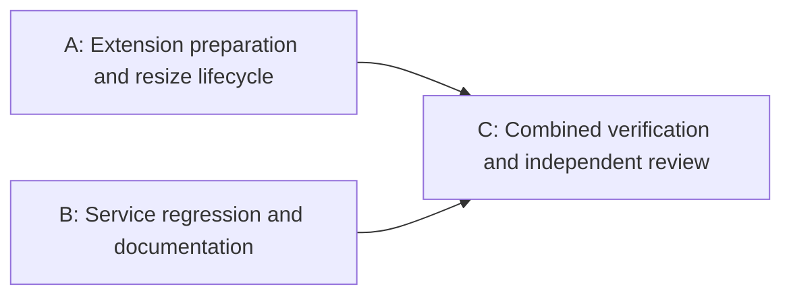

# Borderless Minecraft Resize Implementation Plan

> **For agentic workers:** REQUIRED SUB-SKILL: Use superpowers:executing-plans for inline execution or superpowers:subagent-driven-development for sequential agent execution. Parallel SDD is available if explicitly selected. Track steps using the checkboxes below. Execution requires separate user approval of this plan.

**Goal:** Applying any resize preset removes Minecraft's title bar and borders and resizes the actual window to the requested game-area dimensions, matching the user's selected Jingle behavior.

**Architecture:** Extend the existing GNOME Shell resize implementation with an asynchronous preparation and observation lifecycle. For decorated XWayland Minecraft clients, set `_MOTIF_WM_HINTS` on the exact client window through `xprop`; require Minecraft-owned windowed mode, clear maximization, and observe decoration removal before resizing. Preserve the D-Bus interface and Rust sensitivity sequencing; unsupported decorated native Wayland clients produce an actionable error.

**Tech Stack:** GNOME Shell 50 / Mutter 18, GJS, Gio.Subprocess, GLib timers, XWayland and `xprop` (`x11-utils` on Ubuntu), existing Node VM harness and Rust integration tests.

**Spec:** [Approved design](../specs/2026-10-29-borderless-resize-design.md), approved by the user on 2026-10-29.

## Global Constraints

- The supported desktop remains GNOME Shell 50 on Wayland.
- Preset dimensions describe the undecorated game area. Center the window on its current monitor on every resize (user amendment during supervised 2026-10-29 test).
- Automatic borderless conversion at game launch is outside this change. Monitor centering is explicitly required by the user amendment.
- Distinguish the game's XWayland/native Wayland backend from the desktop session type. Do not silently switch backends.
- Do not assign the read-only `Meta.Window:decorated` property, use a general Mutter ID as an X11 ID, or run synchronous subprocesses in GNOME Shell.
- Preserve existing focus/modal gating, single pending resize, D-Bus signatures, profile format, shortcut behavior, and sensitivity restoration.
- Do not change other applications' decorations or global desktop settings.
- No commits, merges, pushes, installation, or service/extension reloads are authorized by this plan.
- At execution, create `fix/borderless-resize` from `dev` in the primary repository's `.worktrees/fix-borderless-resize`, following the worktree skill and local ignore rules. Carry these uncommitted design/plan documents into that worktree without removing the originals.

## Review Focus

- Compositor-only fullscreen conversion can leave GLFW state inconsistent: refuse fullscreen clients before mutation and require Minecraft's own windowed transition.
- A correct outer frame can conceal an incorrect game area: verify content and frame geometry in the same Mutter coordinate space.
- Asynchronous callbacks can outlive cancellation or disable: complete the D-Bus invocation exactly once and prevent later mutations.
- Two Minecraft instances or focus/modal changes during preparation: retain the original window identity; never retarget another client.
- Missing `xprop`, unusable X11 client IDs, native decorations, or client size limits: report useful failure and never apply eye sensitivity after failure.

---

### Task 1: Prepare decorated XWayland Minecraft windows asynchronously

**Files:** Modify `extension/extension.js`; extend `tests/extension_harness.cjs`.

**Interfaces:** Keep `ResizeFocusedAsync([width, height], invocation)` and its `(uu)` success reply. Replace `_resizeRequests` timer-to-invocation entries with request records that own the original window, invocation, timer, subprocess, cancellation state, and completion guard. Add `_finishResize(request, error = null, dimensions = null)` as the single cleanup/reply path and `_prepareBorderless(request)` for preparation.

- [ ] **Step 1: Pin the GNOME 50 boundary before writing implementation.** Confirm `Meta.Window` content/geometry APIs and the X11 subclass's readable `xwindow` GObject property against the installed Mutter 18 typelib and GNOME 50 source. Confirm GJS access to the runtime subclass property; require an integer in `1..=0xffffffff`. Do not substitute `get_id()` or parse a title. If runtime access cannot be established, resolve the supported client-ID accessor before continuing with this task.
- [ ] **Step 2: Add failing preparation tests.** Expand the VM doubles with `Meta.WindowClientType`, decoration/fullscreen/maximized state, client geometry, a monotonically increasing timer ID, explicit timer ticks, and controlled subprocess completion. Cover a decorated XWayland client with `xwindow=0x1234`, an unrelated general Mutter ID, an already undecorated client, invalid/missing X11 IDs, decorated native Wayland refusal, and already undecorated native Wayland acceptance. Assert no resize while decoration removal is pending and no subprocess for already borderless clients. Read-only boundary research is allowed; do not modify a real game window during this step.
- [ ] **Step 3: Demonstrate failure.** Run `node tests/extension_harness.cjs`; record the expected behavior assertion failure before adding implementation.
- [ ] **Step 4: Implement preparation and request ownership.** Reserve the request before any async operation. For decorated X11 clients, invoke an argument vector equivalent to `xprop -id 0x1234 -f _MOTIF_WM_HINTS 32c -set _MOTIF_WM_HINTS '2, 0, 0, 0, 0'`, without a shell. Resolve `xprop` through GLib and report a missing-tool error mentioning Ubuntu's `x11-utils`. Use Gio async completion, check exit status, and retain the process so cancellation can force exit. Recheck original Minecraft focus/modal state before spawning. Refuse decorated native clients with an explanation that client-side borderless support or an XWayland game is required. Do not alter valid already borderless clients' hints.
- [ ] **Step 5: Verify preparation.** Run `node tests/extension_harness.cjs`. Require passing cases for the exact X11 client target, native refusal, already borderless paths, and untouched non-Minecraft windows.

### Task 2: Apply exact dimensions and close every request lifecycle

**Files:** Modify `extension/extension.js`; extend `tests/extension_harness.cjs`.

**Interfaces:** Use Task 1's request records and completion helper. Keep `GetFocus()` and the public D-Bus XML unchanged. Use the supported GNOME 50 content geometry API established in Task 1, with explicit conversion if it returns a different coordinate space from `get_frame_rect()`.

- [ ] **Step 1: Add failing lifecycle tests.** Assert success only after decorations are absent, fullscreen/maximized state has cleared, and both content and frame match `800×600`. Exercise delayed state changes, an `800×600` frame containing `800×570` content, rejected hints despite successful process exit, a client that refuses dimensions, repeated normal/thin/eye calls, and centering on the current monitor, including nonzero/negative monitor origins and odd dimensions. Test partial horizontal/vertical maximization, not only both axes together.
- [ ] **Step 2: Add failing cancellation tests.** Cover spawn/exit failures, a hung process, overlapping resize calls, focus changing to a second Minecraft window, modal entry, window unmanagement, disable during subprocess/observation, and late completion after cancellation. Assert one reply, no live timer/process, no pending record, and no subsequent resize or hint command after cancellation is observed.
- [ ] **Step 3: Demonstrate failure.** Run `node tests/extension_harness.cjs` and record expected failures for the new lifecycle assertions.
- [ ] **Step 4: Implement staged observation.** Use a 25 ms observation timer and a total deadline of 2 seconds, below Rust's existing 5 second method timeout. Refuse initial fullscreen before mutation, cancel in-flight fullscreen entry, and never call unmake_fullscreen. Clear windowed maximization using GNOME 50 APIs, rechecking focus before each mutation. Wait for maximization to clear and decoration preparation to finish; require `decorated === false`, then request the size at the calculated monitor center. Read the monitor geometry immediately before resizing. Verify content/frame geometry and centered frame position after resize, never returning success merely because polling expired. On deadline, return a descriptive resize error with observed dimensions/state. Route errors, window loss, disable, and success through `_finishResize`; terminate pending processes and remove timers, guarding against late callbacks. Do not attempt to roll back decorations on a window after focus is lost.
- [ ] **Step 5: Verify extension behavior.** Run `node tests/extension_harness.cjs`; require every existing shortcut/FIFO test and new lifecycle test to pass. Review timer iteration in the harness so removed sources cannot be invoked again inadvertently.

### Task 3: Verify service integration, packaged assets, and user guidance

**Files:** Extend `tests/rust_sensitivity.rs` where needed; update `README.md` and `integration/resize-wayland.md`. Inspect existing `tests/rust_gnome.rs` and `tests/rust_assets.rs`; no production Rust or archive layout change is expected.

**Interfaces:** Continue to surface preparation errors through the existing `GnomePeer::resize_focused` error result. The Rust bridge still accepts only exact dimensions; the normal preset must attempt sensitivity restoration even if borderless preparation fails.

- [ ] **Step 1: Add a meaningful integration regression.** Add an eye-preset case where the GNOME peer returns a borderless-preparation error; assert the error propagates and the helper makes no eye write. Reuse the existing fake peer's failure switch. Preserve existing tests for inexact resize and normal-preset restoration on resize failure. Run the added case before any production Rust change; a passing test documents an already satisfied invariant and does not justify changing Rust.
- [ ] **Step 2: Verify service and packaging.** Run `cargo test --test rust_gnome --test rust_sensitivity --test rust_assets` and `node tests/extension_harness.cjs`. The existing build includes `extension/extension.js` in its embedded archive. Keep helpers in that file to avoid adding an archive entry and changing installer ownership rules. Require all commands to exit zero.
- [ ] **Step 3: Update operational guidance.** Explain automatic borderless conversion on preset application, the `xprop`/`x11-utils` dependency for decorated XWayland clients, native Wayland limits, and exact game-area semantics. Require Minecraft-owned windowed mode and test initial fullscreen refusal; also test maximized windowed clients. Include Alt+Tab away/back acceptance after every successful transition. Include visible title-bar/border absence, client backend, repeated normal/thin/eye transitions, unsupported/missing-tool failures, focus/modal cancellation, and unchanged non-Minecraft windows. Mark desktop acceptance pending unless actually observed.
- [ ] **Step 4: Perform final verification and review.** Run `git diff --check`, the targeted checks above, and `graphify update .` after code changes. Inspect the complete diff against the approved spec, especially cancellation, client identity, geometry units, and sensitivity sequencing. Run additional Rust formatting/lint checks only if Rust implementation changes. Use independent review according to the selected execution workflow and repository policy; repair material findings and rerun affected checks.
- [ ] **Step 5: Report evidence and limits.** Report changed files, executed checks/results, optional runtime dependency, worktree/branch, and any unperformed live acceptance. Do not install or reload the extension, mutate a live Minecraft window, commit, merge, or push without the corresponding authorization.

## Research references

- [GNOME 50 X11 window source: client `xwindow` property](https://github.com/GNOME/mutter/blob/50.0/src/x11/window-x11.c)
- [Mutter decoration property](https://gnome.pages.gitlab.gnome.org/mutter/meta/property.Window.decorated.html)
- [GJS asynchronous subprocesses and cancellation](https://gjs.guide/guides/gio/subprocesses.html)

## Approval handoff

The user approved the design and implementation plan, then selected **Parallel SDD** (option 3). Local execution is authorized; commits, merges, pushes, installation, and publishing remain unauthorized.

## Parallel execution ledger

Baseline for both worktrees: `700bff9b6f1aa1c4ac5a9c6941876787e3b8c6c4` (`dev`). Native worktree creation cannot select the repository-required path, so Git worktrees are used under the already ignored primary `.worktrees/` directory. Original untracked design/plan documents remain preserved in the primary checkout.

Tasks 1 and 2 share source/test ownership and form workstream A. The service regression and documentation in Task 3 depend only on the approved contract and form independent workstream B. C requires both implementations for combined behavior and documentation review. No cycles or concurrent overlapping writers.

| Task | Dependencies | Wave | Owned files | Worktree / branch | State | Verification / review |
| --- | --- | --- | --- | --- | --- | --- |
| A | Approved spec/plan | 1 | `extension/extension.js`, `tests/extension_harness.cjs` | `.worktrees/fix-borderless-resize` / `fix/borderless-resize` | complete for XWayland; native boundary pending | RED/GREEN harness passed; GNOME 50 unmaximize signature repaired; Sol review PASS for XWayland |
| B | Approved spec/plan | 1 | `tests/rust_sensitivity.rs`, `README.md`, `integration/resize-wayland.md` | `.worktrees/fix-borderless-resize-service` / `fix/borderless-resize-service` | complete subject to native decision | Targeted Rust 29 passed; service-worktree full suite 326 passed / 47 filtered; docs native claims pending |
| C | A, B | 2 | Patch assembly, Graphify outputs, execution ledger | `.worktrees/fix-borderless-resize` / `fix/borderless-resize` | verified for XWayland; awaiting user input | Combined Node PASS; targeted Rust 29 passed; diff check PASS; graph updated; fresh Sol review PASS for XWayland |

Integration will apply B's reviewed working-tree diff to the topic integration worktree without a commit or merge. The development branch remains untouched. Preserve source worktrees until checks and review finish.

### Execution results and outstanding decision

- A and B working-tree patches were assembled in `fix/borderless-resize` without a commit or merge. Source worktrees remain preserved.
- Initial extension regression RED: `decoration preparation must not resize immediately`; GREEN after implementation: `node tests/extension_harness.cjs` exits zero.
- Independent review found the nonblocking GNOME 50 signature mismatch `unmaximize(flags)`; corrected to `unmaximize()` with zero-argument assertions and horizontal/vertical/both maximization cases. Repair RED/GREEN recorded; fresh follow-up review PASS for assembled XWayland scope.
- Root verification in the combined worktree: `node tests/extension_harness.cjs` PASS; `cargo test --test rust_gnome --test rust_sensitivity --test rust_assets` 29 passed, 3 suites; `git diff --check` PASS.
- `graphify update .` succeeded: 1997 nodes, 5100 edges, 90 communities. AST extraction reports no symbols for `Cargo.toml` and `src/lib.rs`; documentation semantic refresh is separate from this required AST update.
- Real MetaWindowXwayland property access and visible Minecraft/GNOME behavior have not been live-tested. Registered GObject ulong property retrieval through the exact API returned 4660; installed Meta18 and GNOME 50 source establish API shapes.
- **Outstanding required scope decision:** GNOME 50's native Wayland content geometry equals its frame geometry and does not establish the absence of client-side decorations. The original native-undecorated acceptance cannot be verified through this API. The user was asked whether to require XWayland (clear error for all native clients) or investigate a client-side native solution. No answer has arrived yet. Current native acceptance and related documentation are provisional; do not consider the complete feature ready until this is resolved and affected checks/review rerun.
- No commits, merges, pushes, installation, extension/service reloads, or live Minecraft changes performed.

### Current-machine inspection (2026-10-29)

The user identified this machine as the primary acceptance environment and launched the usual Minecraft instance for read-only inspection.

- Ubuntu 26.04.1 LTS, x86_64; GNOME Shell 50.1 (`50.1-0ubuntu1.4`), Mutter18 `50.1-0ubuntu2.4`; desktop session Wayland (`wayland-0`, X display `:0`).
- XWayland `2:24.1.10-1` and `x11-utils 7.7+7build1`; `/usr/bin/xprop` available.
- Saved launcher root `/mnt/data/ubuntu/Documents/tmcsr/launcher`; MCSR Launcher v0.8.10-beta; instance `MCSR_Ranked`, Minecraft 1.16.1, LWJGL 3.3.3. Bundled GLFW reports `3.4.0 Wayland X11 GLX Null EGL OSMesa monotonic shared`; a separate initialization-only probe selected X11 without creating a visible window.
- **Actual running Minecraft confirmed as XWayland:** X11 `_NET_CLIENT_LIST` contains client `0x140000b` with WM_CLASS/title `Minecraft* 1.16.1 - MCSR Ranked`, PID35052 at inspection. Xwininfo reported client 1920x1080 at 0,0, zero border; `_NET_WM_STATE_FULLSCREEN` set and no `_MOTIF_WM_HINTS`. Fullscreen zero extents do not prove borderless windowed behavior. Runtime IDs/PIDs are observation values, not persistent identifiers.
- Saved profile has thin preset 403x1080 on shortcut `b`. Current-machine acceptance must test this exact full-height thin size from fullscreen, including visible titlebar/border absence and content-size verification.
- The configured/running game therefore matches the implemented XWayland scope. Native Wayland support is separate from validating this primary environment; do not treat the desktop's Wayland session as a native Minecraft client.
- Installed extension is ACTIVE but its SHA256 matches the unchanged dev source (`e4fe03d2943e4c6ed2b113b39801bf20d506278f6e4851a8a2930e85e4048d32`), not the candidate (`c884815bf263f331cdeb3261e3a9287e879b12c74d1e550b7c06d09ff8828d6f`). The new implementation is not installed.
- Existing installed toolkit service is restart-looping in `serve --enable-live-keyd`: startup cleanup cannot connect to `/var/run/keyd.socket`; keyd.service is failed/stopped. This is a pre-existing operational blocker for shortcut-through-service acceptance. No recovery, service restart, installed-file change, keybinding change, or Minecraft-window mutation was performed by this inspection.
- Shell `GetWindows` introspection was denied, and was not bypassed. X11 properties independently establish the actual game's backend. Installed toolkit focus reports the terminal at the inspection moment; no focus was changed.

The current-environment read-only inspection is complete. Live borderless acceptance remains unperformed until the candidate is installed/loaded through authorized operations and existing runtime recovery is resolved. Do not conflate this inspection with successful live resizing.

### Supervised Jingle thin test and centering amendment (2026-10-29)

The user authorized live testing with Jingle's default thin resolution. Primary source `DuncanRuns/Jingle` v1.3.0 `src/main/resources/defaultscripts/Resizing.lua` sets Thin BT 280×1000; v2 removes resizing. The live test used X11 border hints and the existing installed GNOME bridge, not the uninstalled candidate lifecycle. Both live Mutter frame and X11 client measured 280×1000 with zero X11 border and no parent frame. The user confirmed the thin size but required the window to stay centered on resolution changes, superseding the original position-preservation requirement.

The live window was moved to820,40 on the 1920×1080 monitor; independently observed center 960,540 matched the monitor center. The user confirmed the centered, borderless result and requested fullscreen restoration. Observed restoration: 1920×1080 at 0,0, fullscreen state present, original absent Motif hint restored, options SHA256 unchanged. No profile, keyd, keyboard mapping, or sensitivity changes were performed. The saved preset remains 403×1080.

A new implementation wave reopened workstream A for centering: current monitor geometry read after preparation; exact center using integer floor; observed frame position required before success; invalid monitor and compositor clamping fail clearly. RED: expected 820,40 but got 10,20. GREEN: extension harness PASS; root reran combined Node and targeted Rust checks (29 passed, 3 suites), diff check PASS. Tests cover negative origin, odd geometry, monitor changes during preparation, invalid monitor, clamping, and repeated sizes. Independent Sol follow-up review PASS: no material findings; reviewer independently reran Node harness and diff check successfully. Graph refresh is recorded below.

Live `_NET_FRAME_EXTENTS` remained stale at 0,0,37,0 after frame removal. The initial metadata-only border check stopped prematurely; actual Mutter/client dimensions plus user observation proved border removal. The source implementation correctly relies on actual geometry rather than that stale property. A typed Motif-hint experiment did not clear the stale metadata; the candidate's exact CARDINAL `xprop` command also worked on the live client.

Centering final verification: root Node harness PASS; targeted Rust tests29 passed across 3 suites; independent review PASS. `graphify update .` rerun after the centering code change. The user-confirmed live thin/center test is complete and fullscreen restored; candidate installation/lifecycle acceptance remains separate.

### Fullscreen/focus regression correction (2026-10-29)

The user reported inability to focus Minecraft via Alt+Tab after the temporary test's external fullscreen restoration. The process remained alive; WM_STATE was Iconic, X map state was UnMapped, and the fullscreen atom was present. Geometry-only restoration and the earlier settled-scope PASS did not establish safe GLFW client state.

Two map/activation attempts (including fresh server timestamp) did not recover focus. A targeted configured native F11 press/release plus remap recovered normal mapped state; GNOME reported Minecraft focus, client 854×480 and frame 854×517. The user confirmed Alt+Tab works again. Leave the game in this working windowed state; do not force compositor fullscreen again. Minecraft itself saved fullscreen:false (options hash 9f4b3a564a5919b99495a6b79137f2d7d28c7f68eeff473ec757abfe33de264a); no direct file edit or process termination occurred.

Independent read-only GLFW3.4 source diagnosis established that external WM fullscreen changes do not clear GLFW's internal monitor pointer; FocusOut can still auto-iconify. The exact process's internal flag was not inspected, so distinguish this supported mechanism and observed native-toggle recovery from a proven complete root-cause trace.

Implementation correction: remove compositor unmake_fullscreen completely; refuse fullscreen before window mutation with actionable native-control guidance, and cancel later fullscreen entry. Keep windowed unmaximize, borderless hints, monitor centering, observed frame/content size and position checks. RED initial fullscreen regression expected one error but got zero; GREEN Node harness passes with new initial and in-flight fullscreen tests. Root combined verification and final independent review recorded after completion. This correction supersedes automatic fullscreen conversion requirements earlier in this plan.

Final fullscreen-guard verification: root extension harness PASS; targeted Rust 29 passed across 3 suites; independent Sol repair review PASS for windowed XWayland scope, independently rerunning Node and diff check. Required AST graph refresh completed after the guard change. The user confirmed Alt+Tab recovery; no required agents remain active. Corrected candidate is not installed, so repeated-preset/Alt+Tab acceptance through the corrected extension and shortcut-through-service remain pending.

### Merge authorization

The user explicitly requested merging this work back to `dev`. This authorizes the necessary local topic commit and `git merge --no-ff fix/borderless-resize` into `dev`, followed by verified topic cleanup under the repository policy. Push, release, installation, and service changes remain outside this request. Pre-existing primary-checkout documents and task-generated scratch files are preserved before any cleanup.
