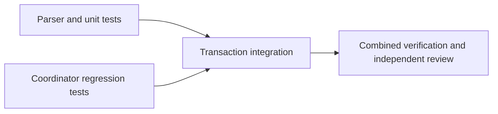

# Standard Settings Implementation Plan

> **For agentic workers:** REQUIRED SUB-SKILL: Use superpowers:executing-plans or the user-selected execution skill to implement this plan task-by-task. Steps use checkbox (`- [x]`) syntax for tracking.

**Goal:** Keep each instance's local Standard Settings controls consistent with the applied profile across world creation, with exact backup and Restore.

**Architecture:** Add a focused Standard Settings parser/renderer and integrate its local files into the existing Apply coordinator's transaction. Retain the existing per-instance `options.txt` backup map for compatibility; add an optional mod-file map with safe relative paths and independent hashes. Preview, Apply, rollback, and Restore account for every managed file.

**Tech Stack:** Rust, existing serde_json/indexmap, existing coordinator integration tests. No new dependencies or UI/API schema changes.

**Spec:** `docs/superpowers/specs/2026-10-29-standard-settings-design.md`

## Global Constraints

- Existing local modern JSON and legacy text only; never write shared targets.
- Preserve disabled settings, global toggles, unrelated values and metadata.
- Missing mod configs remain absent; no mod installation or version migration.
- Defer all activation if any changed target belongs to a running instance.
- Preserve old options-only backups, mutation recovery, and LIFO Restore.
- Reject unsafe paths, malformed configs, and shared redirects before mutation.
- Work in a feature worktree from `dev`. The user subsequently requested a local merge back to `dev`; commit the reviewed feature, merge with `--no-ff`, verify, and clean up task branches/worktrees. Do not push `dev`.

## Review Focus

- An unchanged `options.txt` must not hide a stale mod reset value.
- Synchronize effective emitted bindings rather than physical profile keys or only the latest diff.
- Config file additions/removal or edits between preview, backup, Apply, and Restore must not escape validation.
- Old backup manifests and newly discovered instances must retain their existing restore behavior.
- A shared redirect must not be silently ignored or overwrite a shared file.

### Task 1: Local config discovery and rendering

**Files:** Create `src/standard_settings.rs`, register in `src/lib.rs`, add `tests/rust_standard_settings.rs`.

**Interfaces:** `prepare_local(game_dir: &Path, bindings: &IndexMap<String, String>) -> Result<Vec<ConfigEdit>, StandardSettingsError>`; each `ConfigEdit` carries `path: PathBuf`, `before: Vec<u8>`, and `after: Vec<u8>`. Returns existing recognized local files only, after safe path checks. Enabled entries present in the config receive matching final game bindings; disabled, absent, and blank entries retain their reset behavior.

- [x] Write tests using JSON string and enabled/value control entries, legacy CRLF text, keyboard/mouse/unbound values, unrelated settings, malformed entries, missing paths, symlink ancestors, and both redirect formats. Assert unchanged inputs return identical bytes; enabled stale entries use final bindings; shared targets remain untouched.
- [x] Run `cargo test --locked --test rust_standard_settings` and observe failures before implementation.
- [x] Implement the module using the upstream control IDs and encodings. Preserve JSON metadata semantically and legacy unrelated lines/endings exactly. Validate expected key entry types and fail before any write.
- [x] Run the focused tests; expect all to pass.

### Task 2: Transactional Apply and Restore integration

**Files:** Modify `src/apply.rs`, `tests/rust_apply.rs`, and `README.md`.

**Interfaces:** Extend private `Prepared` with mod edits and private `Manifest` with `#[serde(default)]` mod backup records. Keep existing `files` entries and public reports unchanged. Resolve paths from recognized instance game directories and the fixed config allowlist, never an arbitrary manifest path.

- [x] Add regression tests for effective remaps and chat bindings, mod-only changes/idempotence, absent configs, running-instance deferral, multi-instance validation blocking, rollback on publication failure, exact-byte Restore of both formats, changed config rejection, symlink rejection, shared redirect failures, options-only old manifests, and A/B LIFO Restore including new-instance reconciliation.
- [x] Run `cargo test --locked --test rust_apply -- --test-threads=1`; confirm new assertions fail with current options-only behavior.
- [x] Prepare mod edits from the final rendered game document; include mod differences in per-instance readiness and pending reconciliation. Snapshot and hash managed mod files, verify them before writing, and add attempted writes to reverse-order rollback before each atomic replacement.
- [x] Extend Restore preflight to validate mod file paths, membership and hashes before changes, then restore their exact backup bytes in the existing mutation lifecycle. Preserve parent backup lineage and serde compatibility for old manifests.
- [x] Update README's Apply/Restore workflow with supported local paths, disabled/absent behavior, and actionable redirect limitations.
- [x] Run both focused suites, then `cargo test --locked --no-fail-fast -- --test-threads=1`, `cargo fmt --check`, and `git diff --check`. Record any pre-existing failures by test name.
- [x] Run `graphify update .`, inspect the final diff, and obtain one independent review of the implementation and recovery paths. Repair material findings and rerun affected verification before completion.

## Handoff

Design and plan explicitly approved; user selected Parallel SDD. Baseline: `c54ae8f` on `dev`. The parser and public-coordinator regression tests have no prerequisite on each other, so Task 2's test-writing step runs alongside Task 1. Transaction implementation remains dependent on both outputs.

| Task | Dependencies | Wave | Ownership | Worktree / branch | State | Verification |
| --- | --- | --- | --- | --- | --- | --- |
| A | none | 1 | standard_settings.rs, lib.rs, rust_standard_settings.rs | .worktrees/feat-standard-settings-parser / feat/standard-settings-parser | complete | module-missing RED, 8 focused GREEN; independent source review |
| B | none | 1 | tests/rust_apply.rs | .worktrees/feat-standard-settings-tests / feat/standard-settings-tests | complete | 28 passed / 10 expected RED; original tests pass |
| C | A, B | 2 | src/apply.rs, README.md | .worktrees/feat-standard-settings / feat/standard-settings | complete | 40 Apply + 8 parser GREEN; full suite GREEN |
| D | C | 3 | independent review, graph update | integration worktree | complete | 348 tests passed; independent review PASS |

Primary checkout has pre-existing untracked `graphify-out/cache/last_query_stamp`, preserved. Existing Apply/instance baseline: 37 tests passed. No commits or merges are authorized. Reviewed outputs will be copied as uncommitted files into the integration feature worktree, preserving all source worktrees.

## Execution ledger

- Wave 1 complete: parser output reviewed against upstream source and unit tests; coordinator regression tests reviewed independently. Copied only owned source/test outputs into the integration worktree as uncommitted files. All worktrees originate at `c54ae8f`.
- Used isolated Cargo target directories after discovering cross-worktree artifact interference. Early shared-target full-suite runs are invalid verification evidence. Isolated parser full suite passed; integration baseline full suite also passed before transaction changes.
- Integration RED: `cargo test --locked --test rust_apply --test rust_standard_settings -- --test-threads=1` reported the same 10 missing-feature failures.
- Ruling: retain all closed-instance preparation snapshots, including unchanged files, and distinguish `None` (old options-only manifest) from an explicit new mod-file map. This allows file-set validation and compatible Restore without changing public reports.
- Integration GREEN: 38 Apply tests plus 8 parser tests passed. Added one post-keyd Restore edit regression; it failed before a second snapshot validation was added, then the focused suite passed with 39 Apply tests.
- Full combined verification, graph update, independent recovery review, and local acceptance are complete. Changes remain uncommitted in the integration worktree; no merge or primary-branch integration was performed.

## Final verification and review

- Independent review found one material recovery issue: comparing successive mod-file hashes rejected a newly created repair backup if the mod config had drifted since the previous Apply. Added `restoring_repair_backup_preserves_mod_edits_between_applies`, observed its specific RED failure, and removed that mod-only cross-generation equality requirement. Each generation still validates its own paths, file membership and before/after hashes. The older backup still refuses intervening edits; existing options/history/keyd lineage rules are unchanged.
- Focused recheck: `cargo test --locked --test rust_apply --test rust_standard_settings -- --test-threads=1` passed 48 tests (40 Apply, 8 parser).
- Final full recheck: `cargo test --locked --no-fail-fast -- --test-threads=1` passed 348 tests with zero failures across 22 reported suites; the nested unit-test invocation filtered 47 tests while the normal invocation ran them.
- `cargo fmt --check`, `git diff --check`, and `graphify update .` passed. Final independent focused rereview: PASS, no material defects remaining.
- Complete local output: `.worktrees/feat-standard-settings`, branch `feat/standard-settings`, still based on `c54ae8f`. Parser and test worktrees remain preserved with their original outputs. No commits, merges, pushes, service restarts, or live instance writes were performed.

## Local integration authorization

The user requested "Merge back to dev" after local implementation and independent review passed. Source: `feat/standard-settings`; target: `dev`; strategy: `git merge --no-ff`. Pre-commit verification passed all 348 Rust tests, formatting, and diff checks again. Shared Standard Settings redirects remain an explicitly documented limitation. Preserve primary-checkout draft documents and all task worktree changes in Git-local recovery storage before cleanup. No remote topic branches exist; no development-branch push is requested.
